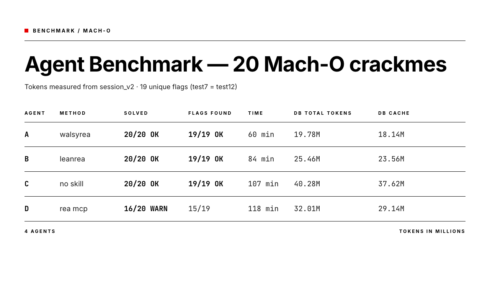

# walsyrea

`skill` · `lrecon` · `reverse-engineering` · `MIT`

**walsyrea** is a read-only reverse-engineering skill for coding agents, built
on top of the [`lrecon`](https://github.com/walsykerem/lrecon) CLI (MIT licensed).
It names the layer hiding inside an artifact — or proves there is none — then
verifies the claim. It refuses rather than guesses, and never writes to the
analysed file.

Dedicated routes and probes for **Go • Rust • C/C++ • Swift • Objective-C •
Java • Kotlin • .NET/C# • Dart • Lua • Erlang • OCaml • Solidity • Move • PHP •
Python • JavaScript/TypeScript • WebAssembly** — from Go build-info and Rust
crate strings to Swift type descriptors, Objective-C class lists, ECMA-335
members, DEX classes, BEAM chunks, EVM selectors, `.pyc` code objects, JS
bundles and WASM interfaces. Formats include ELF/Mach-O/PE, APK/AAB/IPA,
asar, SQLite, plist, pcap, firmware and model artifacts. Detection is
digest-driven: a bare marker without a digest field stays `unknown`, so the
tool reports the gap instead of inventing a verdict.

## Jump to Download

**Jump to:** [Claude Code](#claude-code) · [OpenAI Codex CLI](#openai-codex-cli) · [OpenCode](#opencode) · [DeepSeek Harness](#deepseek-harness) · [Cline](#cline) · [Qwen Code](#qwen-code) · [Kimi Code](#kimi-code) · [Pi](#pi) · [Aider](#aider) · [Goose](#goose) · [Meta Code](#meta-code) · [ZCode](#zcode) · [MiniMax Code](#minimax-code) · [Antigravity CLI](#antigravity-cli) · [Crush](#crush) · [OpenHands](#openhands) · [Hermes Agent](#hermes-agent) · [Oh My Pi](#oh-my-pi) · [Kilo Code](#kilo-code) · [Kiro](#kiro) · [Zed Agent](#zed-agent) · [Cursor](#cursor) · [Devin Desktop](#devin-desktop) · [Factory Droid](#factory-droid) · [Forge](#forge)

## Benchmark

Four agents, the same 20 Mach-O crackmes, the same machine. Tokens come from
`session_v2`, not agent self-reports; `test7` and `test12` are the same binary,
so 20 runs yielded 19 unique flags.



## What the skill changed

All three CLI agents solved every target; the difference was cost. walsyrea
used 60 min / 19.78M tokens vs 107 min / 40.28M with no skill (44% faster,
51% fewer tokens), and 24 min / 5.68M tokens less than leanrea. The skill
replaces the guess-and-retry loop with a route table and an op index; the
evidence-first contract stops re-reading the same target. Cache follows the
same curve: 18.14M cached tokens vs 37.62M with no skill. The MCP path solved
only 16/20 and found 15/19 flags while taking longest — every op here is one
local call with a typed result, nothing is lost in a tool bridge.

## When to use walsyrea

- **Triage an unknown file** — native binaries, mobile packages, bundles,
  archives, firmware, captures, databases.
- **Answer a specific question** — imports, symbols, strings, sections,
  packed resources, signatures, device state, page or bundle contents.
- **Work offline** — one static binary, no installer, no runtime, no network.
- **Automate an agent loop** — `--json` gives stable output; refusals carry a
  `kind` from a closed set.
- **Stay read-only** — no op writes to the target; the few device-mutating
  ops (install, push, start, stop, capture) are named explicitly.

Not for live-process instrumentation, iOS devices, GUI-only flows, or a full
decompiler session.

## Usage patterns

Start with identity, then ask one question at a time:

```sh
walsyrea --version               # must print lrecon 1.0.0, otherwise stop
walsyrea --json /path/to/target  # digest first — every later op needs it
walsyrea --op binary_overview /path/to/target --json
LRECON_QUERY=FLAG walsyrea --op search_strings /path/to/target --json
```

**Source → binary → analysis.** Ask your AI assistant to compile source to a
real ELF/Mach-O/PE (with symbols if possible), save it, then let walsyrea read
it: "Compile this C/Rust/Go source to `/tmp/target` and keep debug symbols.
Now use walsyrea to list strings, symbols and functions in `/tmp/target`, then
explain what it found." This works because the string, symbol and Ghidra
probes consume machine code, not source text.

**APK with native libraries.** Extract first, then point walsyrea at the
`.so` inside: `walsyrea --op extract_artifact <apk> -o DIR`, followed by
`walsyrea --json DIR/lib/arm64-v8a/libfoo.so`.

**Web/JS bundle.** `walsyrea --json bundle.js`, then `analyze_web_bundle` or
`recover_javascript_sources` if a source map is present.

## Theoretical advantage — when converting to binary pays off

The advantage is real only when the target contains **actual native code**.

- walsyrea's string, symbol and Ghidra probes expect ELF/Mach-O/PE. On a DEX
  APK, `list_strings` returned `bad_arg`; a binary form unlocks those probes.
- The Ghidra decompiler understands machine code, not Dalvik bytecode.
- So conversion pays off when the APK ships native `.so` libraries, or when a
  genuine DEX→native compilation (`dex2oat`/AOT) can be produced.

It costs a plan change, lost layer structure, opaque data, and ~3 min of empty
Ghidra work — and byte-preserving reads are not counted as `solved`
evidence. In the APK we tested, both inventories agreed: **no `.so` at all**;
the module logic is entirely in Dalvik. The direct APK/mobile route was
correct. Wrapping that DEX in an empty Mach-O moved walsyrea out of its strong
area (APK/mobile) into a weak one (a native wrapper with nothing in it). Use
binary-first only for native payloads or real `dex2oat` output.

## How this was built

The benchmark table, its 19 style variants and this README were produced with
**OpenCode**, using the **ponytail** and **caveman** skills in **ultra** mode:
smallest change that fully solves the task, terse output, no unrequested
scaffolding. All deliverables are English. Decisions — row order, the
`no skill` label, font-safe `OK`/`WARN` instead of emoji, and `session_v2` as
the token source — were checked with **System One** before being applied.

## Repository

| Path | What it is |
|---|---|
| `assets/walsyrea.png` | benchmark table used above |
| release package | static binaries for Windows/macOS/Linux, the skill, `README.md`, `SHA256SUMS.txt` |

## License

MIT — see `LICENSE` in the release package.

## Download

Install the CLI once, then copy the skill into your agent:

```sh
npm install -g walsyrea
walsyrea --skill-path    # prints the folder containing SKILL.md
```

Pick your harness below. Commands install for the current user; to scope to a
single repo, use the project path shown in each subsection instead. The target
folder must be named `walsyrea` (it matches `name:` in `SKILL.md`). Paths use
`~` for the home directory (Windows: `%USERPROFILE%`); the `/.'` copy form puts
`SKILL.md` directly in the target folder, the plain folder form copies it as a
subfolder — both are correct for the harnesses shown.

Order: most commonly used first.

<a id="claude-code"></a>
### Claude Code

User-wide `~/.claude/skills/walsyrea/`, or project `<repo>/.claude/skills/walsyrea/`.

```sh
mkdir -p ~/.claude/skills/walsyrea
cp -R "$(walsyrea --skill-path)/." ~/.claude/skills/walsyrea/
```

Verify: `/skills` lists `walsyrea` (fresh session is safest) or run `claude doctor`.

<a id="openai-codex-cli"></a>
### OpenAI Codex CLI

User-wide `$HOME/.agents/skills/walsyrea/`, or repo `<repo>/.agents/skills/`.
(`~/.codex/skills` is not in current official docs.)

```sh
mkdir -p "$HOME/.agents/skills/walsyrea"
cp -R "$(walsyrea --skill-path)/." "$HOME/.agents/skills/walsyrea/"
```

Verify: `/skills`, or type `$` and mention the skill.

<a id="opencode"></a>
### OpenCode

Global `~/.config/opencode/skills/walsyrea/`, project `<repo>/.opencode/skills/walsyrea/`.
Also scans `~/.claude/skills` and `~/.agents/skills`.

```sh
mkdir -p ~/.config/opencode/skills/walsyrea
cp -R "$(walsyrea --skill-path)/." ~/.config/opencode/skills/walsyrea/
```

Verify: restart OpenCode; the skill is loadable with ID `walsyrea`. Alternative:
add the absolute skill path to the `skills` array in `opencode.json`.

<a id="deepseek-harness"></a>
### DeepSeek Harness

User-global `~/.dsh/skills/walsyrea/` (or `$DSH_HOME/skills/`), project
`<repo>/.dsh/skills/`. `SKILL.md` must be a direct child of `walsyrea/`.

```sh
mkdir -p ~/.dsh/skills/walsyrea
cp -R "$(walsyrea --skill-path)/." ~/.dsh/skills/walsyrea/
```

Verify: ask in `dsh` to use the `walsyrea` skill; roots are watched, no restart.

<a id="cline"></a>
### Cline

Global `~/.cline/skills/walsyrea/`, workspace `.cline/skills/walsyrea/`.
Folder name must match `name:` in `SKILL.md`.

```sh
SKILL_PATH="$(walsyrea --skill-path)"
mkdir -p ~/.cline/skills
cp -R "$SKILL_PATH" ~/.cline/skills/walsyrea
```

Verify: Cline panel → Skills tab shows `walsyrea` enabled, or run `/walsyrea`.

<a id="qwen-code"></a>
### Qwen Code

User-wide `~/.qwen/skills/walsyrea/`, project `.qwen/skills/walsyrea/`.

```sh
mkdir -p ~/.qwen/skills
cp -R "$(walsyrea --skill-path)" ~/.qwen/skills/walsyrea
```

Verify: `/skills` lists `walsyrea`, or run `/walsyrea` (next session/reload).

<a id="kimi-code"></a>
### Kimi Code

User-level `~/.kimi-code/skills/walsyrea/`, project `.kimi-code/skills/walsyrea/`.

```sh
mkdir -p ~/.kimi-code/skills
cp -R "$(walsyrea --skill-path)" ~/.kimi-code/skills/walsyrea
```

Verify: new session, then `/skill:walsyrea`. `SKILL.md` needs `name:` and
`description:`.

<a id="pi"></a>
### Pi

User-level `~/.pi/agent/skills/walsyrea/`, project `.pi/skills/walsyrea/`.
Also discovers `~/.agents/skills/`.

```sh
mkdir -p ~/.pi/agent/skills
cp -R "$(walsyrea --skill-path)" ~/.pi/agent/skills/walsyrea
```

Verify: startup diagnostics list `walsyrea`, then `/skill:walsyrea` (`/reload`
after editing in an active session).

<a id="aider"></a>
### Aider

Aider has **no skill system**. Closest supported option is context injection:
load `SKILL.md` as a read-only file via `.aider.conf.yml`. This is not a real
skill install; `references/` and `scripts/` need their own `read:` entries.

```sh
SKILL_PATH="$(walsyrea --skill-path)"
# if .aider.conf.yml already has a read: list, add the path to it instead
echo "read: $SKILL_PATH/SKILL.md" >> .aider.conf.yml
```

Verify: start `aider`, run `/ls` and confirm `SKILL.md` is listed read-only.

<a id="goose"></a>
### Goose

Global `~/.agents/skills/walsyrea/`, project `.agents/skills/walsyrea/`.

```sh
mkdir -p ~/.agents/skills
cp -R "$(walsyrea --skill-path)" ~/.agents/skills/walsyrea
```

Verify: `goose skills list` shows `walsyrea`, or use `/skills` in a session.

<a id="meta-code"></a>
### Meta Code (Muse Code)

Native CLI — no manual copy. `muse skills install` copies into
`~/.config/muse/skills/walsyrea` (`$XDG_CONFIG_HOME/muse` if set).

```sh
SKILL_PATH="$(walsyrea --skill-path)"
muse skills validate "$SKILL_PATH"
muse skills install "$SKILL_PATH"
```

Verify: `muse skills list` shows `walsyrea` (scope `user`); `muse skills inspect walsyrea`.

<a id="zcode"></a>
### ZCode

User-level `~/.zcode/skills/walsyrea/`, project `.zcode/skills/walsyrea/`.

```sh
mkdir -p ~/.zcode/skills
cp -R "$(walsyrea --skill-path)" ~/.zcode/skills/walsyrea
```

GUI alternative: Settings → Skills → Import. Verify: Settings → Skills → Refresh
shows `walsyrea`; invoke `$walsyrea`.

<a id="minimax-code"></a>
### MiniMax Code

Global `~/.agents/skills/walsyrea/`, project `.agents/skills/walsyrea/`.

```sh
mkdir -p ~/.agents/skills
cp -R "$(walsyrea --skill-path)" ~/.agents/skills/walsyrea
```

Verify: `/skills` lists `walsyrea`; invoke `/walsyrea`.

<a id="antigravity-cli"></a>
### Antigravity CLI

Global `~/.gemini/config/skills/walsyrea/`, project `.agents/skills/walsyrea/`.
Native plugin route also exists: `agy plugin install <dir-or-url>`.

```sh
mkdir -p ~/.gemini/config/skills
cp -R "$(walsyrea --skill-path)" ~/.gemini/config/skills/walsyrea
```

Verify: `/skills reload` (or new conversation), then `/walsyrea`.

<a id="crush"></a>
### Crush

Project-local `.agents/skills/walsyrea/` (also `.crush/skills/`).

```sh
mkdir -p .agents/skills
cp -R "$(walsyrea --skill-path)" .agents/skills/walsyrea
```

Verify: restart Crush, type `/` and confirm `walsyrea`. Custom dirs:
`option skill-path <dir>` in `crushrc`.

<a id="openhands"></a>
### OpenHands

Global `~/.agents/skills/walsyrea/`, project `.agents/skills/walsyrea/`.

```sh
mkdir -p ~/.agents/skills
cp -R "$(walsyrea --skill-path)" ~/.agents/skills/walsyrea
```

Verify: new conversation (skills load at session start).

<a id="hermes-agent"></a>
### Hermes Agent

Primary `~/.hermes/skills/walsyrea/`, project `.hermes/skills/walsyrea/`
(needs `hermes skills trust`).

```sh
mkdir -p ~/.hermes/skills
cp -R "$(walsyrea --skill-path)" ~/.hermes/skills/walsyrea
```

Verify: `hermes skills list` shows `walsyrea`; also `/walsyrea`.

<a id="oh-my-pi"></a>
### Oh My Pi

User `~/.omp/agent/skills/walsyrea/`, project `.omp/skills/walsyrea/`.
Discovery is one level deep — no extra folder between `skills/` and `walsyrea/`.

```sh
mkdir -p ~/.omp/agent/skills
cp -R "$(walsyrea --skill-path)" ~/.omp/agent/skills/walsyrea
```

Verify: `omp skill list --json`, then `/skill:walsyrea`.

<a id="kilo-code"></a>
### Kilo Code

Global `~/.kilo/skills/walsyrea/`, project `.kilo/skills/walsyrea/`.
Also loads `.agents/skills/` by default.

```sh
mkdir -p ~/.kilo/skills
cp -R "$(walsyrea --skill-path)" ~/.kilo/skills/walsyrea
```

Verify: `/` menu → Skills group shows `/walsyrea`.

<a id="kiro"></a>
### Kiro

Workspace `.kiro/skills/walsyrea/`, global `~/.kiro/skills/walsyrea/`.

```sh
mkdir -p .kiro/skills
cp -R "$(walsyrea --skill-path)" .kiro/skills/walsyrea
```

Verify: type `/` in chat (CLI) or check Agent Steering & Skills (IDE) lists
`walsyrea`; invoke `/walsyrea`.

<a id="zed-agent"></a>
### Zed Agent

Global `~/.agents/skills/walsyrea/`, project `.agents/skills/walsyrea/`
(trusted worktree). Flat layout only. Symlink is fine:
`ln -s "$(walsyrea --skill-path)" ~/.agents/skills/walsyrea`.

```sh
mkdir -p ~/.agents/skills
cp -R "$(walsyrea --skill-path)" ~/.agents/skills/walsyrea
```

Verify: Settings → AI > Skills (`zed://settings/agent.skills`), then `/` or
`@skill`. Live reload, no restart.

<a id="cursor"></a>
### Cursor

Project `.cursor/skills/walsyrea/` (or `.agents/skills/`), global
`~/.cursor/skills/walsyrea/`. Also loads `.claude/skills/`.

```sh
mkdir -p .cursor/skills
cp -R "$(walsyrea --skill-path)" .cursor/skills/walsyrea
```

Verify: Agent chat → `/` lists `walsyrea`; invoke `/walsyrea`.

<a id="devin-desktop"></a>
### Devin Desktop (formerly Windsurf)

Workspace `.devin/skills/walsyrea/`, global `~/.config/devin/skills/walsyrea/`
(macOS/Linux). Active agent is Devin Local.

```sh
mkdir -p .devin/skills
cp -R "$(walsyrea --skill-path)" .devin/skills/walsyrea
```

Verify: Customize → Skills tab lists `walsyrea`; invoke `/walsyrea`.
Windows global: `%APPDATA%\devin\skills\walsyrea\`.

<a id="factory-droid"></a>
### Factory Droid

Personal `~/.factory/skills/walsyrea/`, project `.factory/skills/walsyrea/`.

```sh
mkdir -p ~/.factory/skills/walsyrea
cp -R "$(walsyrea --skill-path)/." ~/.factory/skills/walsyrea/
```

Verify: restart Droid → `/skills` shows `walsyrea` Enabled; `/walsyrea`.

<a id="forge"></a>
### Forge

Global `~/forge/skills/walsyrea/`, project `.forge/skills/walsyrea/`.
This is the `tailcallhq/forgecode` CLI.

```sh
mkdir -p ~/forge/skills/walsyrea
cp -R "$(walsyrea --skill-path)/." ~/forge/skills/walsyrea/
```

Verify: `forge` → `:skill` lists `walsyrea`.
